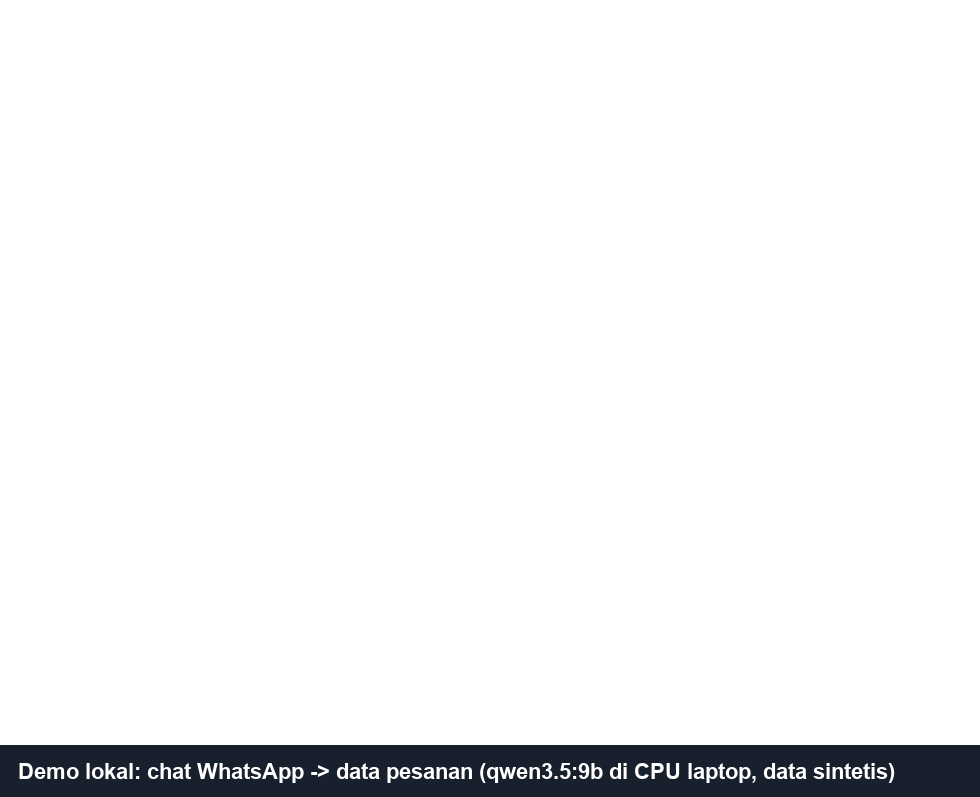

# Ekstraksi Pesanan dari Chat Cargo

Mengubah chat WhatsApp pelanggan forwarding China → Indonesia menjadi data pesanan terstruktur,
lalu membuat pertanyaan balik untuk info yang kurang. Berjalan **lokal dan gratis** dengan model
open-source (Ollama), dan **dievaluasi pada chat asli** dari bisnis keluarga (Pelita Cargo).

```
chat ──► buang template ──► LLM lokal ──► EkstraksiLLM ──► validator ──► Pesanan + pertanyaan balik
         (quick reply admin)  (qwen3.5:9b)   apa yang         (kode Python: satuan, CBM, cek wajar,
                                             dikatakan        minimum tarif, alias kota, info kurang)
```

Contoh: `一共5件，每件 50*50*40，总重 160斤，大概0.5方，到泗水` → 5 koli, 50×50×40 cm, 80 kg, 0,5 CBM,
Surabaya, lalu pertanyaan balik dalam bahasa pelanggan: `走海运还是空运？`



*Demo lokal dengan chat dan gambar sintetis. Waktu tunggu model (±1–3 menit di CPU laptop) dipercepat.*

## Masalahnya

Admin menerima ±20 pertanyaan harga per minggu. Info pelanggan pendek, tersebar di beberapa pesan,
bercampur dengan template admin, dan sering tidak lengkap. Pola khasnya (contoh sintetis): satu
pesan "60 × 50 × 40 cm brp kak?" plus foto, lalu "beratnya 20an kg" dan "kirim ke Medan ya" di hari
berikutnya. Admin harus menyalin angka, menghitung CBM, memilih kategori tarif, lalu menanyakan yang
kurang.

## Keputusan desain

- **LLM hanya membaca, kode yang menghitung.** Model menyalin angka dan satuan apa adanya (斤, m, mm).
  Konversi, CBM, minimum tarif, dan cek kewajaran dikerjakan Python biasa yang diuji tanpa model.
  Validator menangkap kesalahan model, misalnya berat 0,1 kg untuk 0,1 CBM (densitas 1 kg/m³).
- **Lokal, tanpa API berbayar.** `qwen3.5:9b` lewat Ollama di CPU laptop (±40–60 detik per chat).
  Output dibatasi skema Pydantic (structured output).
- **Urutan kolom skema berpengaruh.** Model mengisi JSON dari atas. Saat `jumlah_koli` ada di depan
  ukuran, "65 × 45 × 50 cm" dibaca sebagai 65 koli. Memindahkan ukuran ke depan memperbaikinya;
  menambah contoh di prompt tidak berpengaruh. Kedua perubahan diuji terpisah, dan ada tes yang
  menjaga urutan ini.
- **Template admin dibuang sebelum dikirim ke model.** Quick reply (pricelist, cara kirim, alamat
  gudang) membuat model mengarang kota "Jakarta" dan membaca "20pcs" sebagai 20 koli.
- **Privasi.** Chat asli disamarkan berbasis aturan (nama, nomor HP termasuk tanpa kode negara,
  rekening, WeChat, alamat sampai tingkat kelurahan, marking, nomor dokumen), lalu diperiksa otomatis
  dan dibaca manual. Chat asli, hasil samaran, dan hasil evaluasinya tidak pernah di-commit. Halaman
  Streamlit hanya terbuka di localhost.

## Data dan cara melabel

- **Sumber:** 57 ekspor WhatsApp, dipotong menjadi 70 episode percakapan; 61 di antaranya permintaan
  harga yang dilabel. Satu contoh data = satu permintaan harga.
- **Titik potong:** input berhenti tepat sebelum admin memberi harga untuk barang itu. Tanpa ini,
  model bisa "menyontek" jawaban admin (hitungan CBM, kategori). Label hanya berisi apa yang
  dikatakan pelanggan sebelum titik potong. Kategori dan branded adalah keputusan tarif admin.
- **Split (dua putaran):**
  - Putaran 1: 5 episode dev untuk memperbaiki prompt v3–v6, lalu 23 episode test.
  - Putaran 2: ke-28 episode itu menjadi dev untuk v8, lalu 33 episode test dari ekspor baru. Ekspor
    baru ini dibuka setelah v8 dan daftar kategori dibekukan.
  - Ditambah 4 chat sintetis untuk kasus Mandarin/Inggris.
- **Alat:** `app/tandai.py` untuk menandai jenis episode dan titik potong (dengan saran otomatis),
  dan `app/label.py` untuk melabel dengan isian awal yang dikoreksi admin. Aturannya ada di
  [`docs/panduan_label.md`](docs/panduan_label.md).

## Hasil (test: 23 chat asli)

| Kolom | v6 (prompt beku) | v7 (+ tabel kategori Pelita) |
|---|---|---|
| Jumlah koli | 100% | 100% |
| CBM | 100% | 100% |
| Kota tujuan | 100% | 100% |
| Ukuran (grup koli) | 96% | 96% |
| Jalur (laut/udara) | 91% | 91% |
| Berat | 87% | 100% |
| Jenis barang | 74% | 74% |
| Branded (tarif udara) | 60% | 60% |
| Kategori (tarif laut) | 6% | **35%** |
| Info kurang (set persis sama) | 65% | 78% |
| **Chat benar di semua kolom** | **5/23** | **9/23** |

Kolom v7 diukur dengan kode di repo ini. Sebelum commit pertama, satu contoh angka di docstring
skema diganti angka buatan (privasi). Docstring itu ikut masuk prompt, dan perubahan sekecil itu
saja sudah mengubah output mentah di 19 dari 28 chat. Status per kolom berubah di 4 chat (v7 sebelumnya:
8/23). Jadi selisih 1–3 chat antarversi masih dalam batas noise.

Cara membaca:
- Info yang **diucapkan pelanggan** (koli, CBM, kota, ukuran, jalur, berat) sudah kuat.
- Yang lemah adalah **keputusan tarif admin**. Kategori lartas ringan/berat mengikuti aturan impor
  yang samar, dan model cenderung menebak "umum".
- Jenis barang sering terlewat kalau disebut di kalimat biasa, bukan di formulir.
- Setiap kolom dipisah menjadi benar / salah / halusinasi / terlewat. Daftar kegagalan per chat
  disimpan untuk analisis.
- Evaluasi juga menemukan satu **kesalahan label** (pelanggan menulis "ke Jakarta" tapi label
  kosong); label itu dikoreksi dan dicatat.

## Eksperimen: contoh dari riwayat keputusan admin (retrieval)

Model tidak dilatih ulang; pengetahuan admin dimasukkan lewat prompt. Untuk tiap chat, sistem mencari
chat berlabel lain yang mirip (embedding lokal `qwen3-embedding:0.6b`). Keputusan admin di chat itu
(jenis barang → kategori, branded) lalu ditambahkan ke prompt v7. Pengukuran pakai leave-one-out:
contoh dari pelanggan (ekspor) yang sama tidak pernah dipakai. Bank berisi 21 contoh.

| 23 chat test | v7 | v7 + 5 contoh termirip | v7 + semua contoh |
|---|---|---|---|
| Kategori | 35% | 35% | 47% |
| Branded | 60% | 60% | 55% |
| Jalur | 91% | 87% | 83% |
| Info kurang | 78% | 65% | 65% |
| Chat benar di semua kolom | **9/23** | 6/23 | 7/23 |

Hasilnya **tidak lebih baik**, jadi tidak dipakai sebagai bawaan (`--riwayat` tetap tersedia):
- Barang pelanggan hampir semuanya unik, jadi contoh "termirip" sering hanya kebetulan
  (kemiripan nama barang 0,56–0,74).
- Teks tambahan mengganggu kolom lain (jalur, info kurang) pada model 9B.
- Semua kesalahan kategori sama polanya: admin memutuskan lartas, model menebak "umum".
  Tebakan "lartas ringan" untuk semua chat saja sudah 55%. Masalahnya ada pada batas "umum" di
  prompt, bukan kurang contoh.

Perlu diukur ulang setelah data berlabel bertambah.

## v8 + daftar kategori admin

Perbaikan kategori dilakukan lewat aturan, bukan contoh:
- **Prompt v8**: "umum" dipersempit (barang sederhana tanpa mesin/listrik); lartas ringan jadi bawaan.
  Model lalu bias ke arah sebaliknya (barang umum ditebak lartas ringan).
- **Daftar kata admin** ([`data/referensi/kategori_kata.csv`](data/referensi/kategori_kata.csv)) dibaca
  **kode**, bukan model. Barang yang ada di daftar memakai kategori admin. Barang di luar daftar memakai
  tebakan model dan diberi peringatan `kategori_perlu_dicek`. Admin bisa terus menambah daftar ini.

Di 28 chat lama (dev), kategori naik dari 35% ke 70%. Angka ini terlalu optimis, karena daftar sebagian
dibuat dari barang di chat-chat itu.

### Test baru: 33 chat dari ekspor baru (dibuka setelah v8 dibekukan)

| Kolom | v7 (tanpa daftar) | v8 + daftar |
|---|---|---|
| Jumlah koli | 94% | 97% |
| Kota tujuan | 97% | 97% |
| CBM | 94% | 91% |
| Ukuran (grup koli) | 91% | 91% |
| Jalur | 91% | 91% |
| Berat | 94% | 88% |
| Jenis barang | 82% | 76% |
| Branded (tarif udara) | 62% | 62% |
| Kategori (tarif laut) | 42% (8/19) | **53% (10/19)** |
| Info kurang (set persis sama) | 67% | 61% |
| **Chat benar di semua kolom** | **12/33** | **12/33** |

Cara membaca:
- **Kategori membaik** (+2 dari 19 chat). Kalau hanya dihitung chat yang tarif lautnya diputuskan admin:
  8/14 → 10/14. Lima kesalahan lartas → "umum" dari v7 hilang. Gantinya, dua barang umum
  (aksesoris hamster, stiker) kini ditebak lartas ringan. Keduanya mendapat peringatan cek admin.
- **Kolom lain praktis sama.** Selisih 1–2 chat masih dalam batas noise (lihat catatan docstring di atas).
  Info dari pelanggan: 212/231 (92%) vs 208/231 (90%).
- **Kebocoran daftar diperiksa.** Tiga kata di daftar (mesin, socket, metal detector) ternyata juga
  barang di chat test. Tanpa ketiga kata itu, hasil v8 tetap sama (kategori 53%).
- **Hasil putaran 1 bertahan di data baru:** v7 9/23 (39%) di test lama vs 12/33 (36%) di test baru.
- **Kesalahan terbesar yang tersisa: `branded` kosong (10 chat).** Admin hampir selalu memberi tarif
  non-branded 220rb, tapi model mengisi kosong kalau merek tidak disebut.
- Sebagian kesalahan "jenis barang" sebenarnya sinonim atau terjemahan ("tombol setir" vs label
  "steering wheel buttons", "casing hp" vs "case hp"). Sekarang metrik mengabaikan urutan kata, dan
  label boleh memuat beberapa nama yang diterima (dipisah `|`). Aturan ini diterapkan sama ke semua
  versi; angka putaran 1 tidak berubah.

## Tahap 2: membaca foto pelanggan (percobaan kecil)

Pelanggan sering mengirim foto atau screenshot toko (Taobao/Alibaba/AliExpress) alih-alih menulis nama
barang. `qwen3.5:9b` juga bisa membaca gambar, jadi foto dibaca lebih dulu menjadi nama barang singkat dan
disisipkan ke chat sebagai `[foto: ...]` ([`foto.py`](src/cargo_extract/foto.py)). Model foto hanya diminta
menyebut barang dan merek. Di uji awal, model menyalin ukuran produk dari halaman toko dan mengarang
"1 unit", padahal itu bukan info kiriman. Gambar diperkecil dulu: di CPU laptop, ukuran asli butuh
30–190 detik per foto.

Diuji di 17 chat berlabel yang punya foto pelanggan sebelum titik potong (22 foto). Jenis barang dinilai
dengan label "setelah melihat foto" (`app/label_foto.py`, dicek pengguna).

| 17 chat dengan foto | Teks saja | + foto 768 px | + foto 1024 px |
|---|---|---|---|
| Jenis barang | 65% (11/17) | **82% (14/17)** | 76% (13/17) |
| Kategori (tarif laut) | 50% (6/12) | **75% (9/12)** | **75% (9/12)** |
| Info kurang | 35% | 71% | 65% |
| Chat benar di semua kolom | 2/17 | 4/17 | 3/17 |
| Foto terbaca benar (dinilai manual) | – | 17/22 | 20/22 |
| Waktu baca per foto | – | 13–26 detik | 29–41 detik |

Cara membaca:
- **Foto paling berguna saat barang hanya ada di foto.** Contohnya phone farm, alat infus, dan baterai
  Li-ion beserta tiang karbon. Baterai Li-ion ternyata barang yang tidak bisa dikirim, jadi foto juga
  bisa memberi peringatan.
- **Model ekstraksi sering mengabaikan `[foto: ...]`.** Di keempat chat yang barangnya hanya ada di foto,
  foto terbaca benar tapi jenis barang tetap kosong. Karena itu kode mengisi jenis dari deskripsi foto
  bila ekstraksi kosong. Aturan ini ditambahkan **setelah** melihat hasil pertama. Tanpa aturan ini,
  jenis barang 71% (768 px) dan 65% (1024 px).
- **1024 px membaca foto lebih akurat** (20/22 vs 17/22), tapi skor akhirnya tidak lebih tinggi. Selisihnya
  datang dari cara label ditulis (mis. "teh hijau" tidak cocok dengan label "daun teh"). Bawaan: 1024 px.
- **Ini percobaan kecil, bukan test independen.** Ke-17 chat campuran dev dan test, prompt foto
  dirancang setelah melihat 4 foto, dan packing list hanya ada ±2 sehingga belum diukur.

## Keterbatasan

- Test kecil: 23 chat (putaran 1, sudah dipakai beberapa kali) dan 33 chat (putaran 2, dipakai sekali
  untuk v7 vs v8). Kategori dinilai di 19 chat, jadi satu chat = ±5%.
- Semua chat asli berbahasa **Indonesia**. Kemampuan Mandarin/Inggris baru diuji dengan data
  sintetis.
- Foto baru diuji di 17 chat. Packing list (±2) belum diukur.
- Belum tersambung langsung ke WhatsApp; chat masih disalin atau diekspor manual. Sambungan otomatis
  butuh WhatsApp Business Platform (API resmi Meta), dan itu keputusan bisnis.
- Kategori untuk barang di luar daftar admin masih tebakan model; karena itu selalu ditandai untuk dicek.

## Menjalankan

Butuh Python 3.12+ dan [Ollama](https://ollama.com).

```bash
py -m venv .venv
.venv\Scripts\activate
pip install -e ".[dev]"
copy .env.example .env
ollama pull qwen3.5:9b
ollama pull qwen3-embedding:0.6b   # hanya untuk eksperimen --riwayat
pytest
streamlit run app/streamlit_app.py           # demo, contoh chat sintetis di sidebar
python -m evaluasi.jalankan --split dev      # evaluasi pada chat sintetis
```

Memakai demo:
- **Tempel chat apa adanya.** Pilih pesan di WhatsApp Desktop/Web, salin, lalu tempel. Sistem mengenali
  format `[jam, tanggal] Nama: teks`, menebak pengirim admin (dari "You"/"Anda" atau pesan template
  admin), dan memisahkan pesan admin dan pelanggan sendiri. Tebakan admin bisa dikoreksi sekali.
- **Atau unggah file ekspor** chat (.txt, atau .zip berikut fotonya). Chat dipotong per percakapan
  (jeda 7 hari), dan yang terakhir dipilih otomatis.
- **Foto barang** bisa diunggah tambahan. Foto dibaca bila "Baca foto barang" menyala (±30–40 detik per foto).
- Semua berjalan di laptop. File unggahan hanya disimpan di folder sementara.

Alur chat asli (semua hasilnya di `data/privat/`, tidak di-commit):

```bash
python scripts/impor_whatsapp.py data/raw/<folder>/chat.txt --nama <nama admin>
streamlit run app/tandai.py      # jenis episode + titik potong
streamlit run app/label.py       # label (isian awal dikoreksi admin)
streamlit run app/label_foto.py  # tahap 2: jenis barang setelah melihat foto
python -m evaluasi.jalankan --split asli-test
python -m evaluasi.jalankan --split foto --foto   # teks + foto
python -m evaluasi.bandingkan <folder_run_a> <folder_run_b>
```

## Struktur

| Folder | Isi |
|---|---|
| `src/cargo_extract/` | skema, pembaca WhatsApp, penyamar, buang template, extractor, pembaca foto, validator, pertanyaan balik, pipeline |
| `prompts/` | versi prompt v1–v8 (baku: v8) |
| `evaluasi/` | menjalankan evaluasi, metrik per kolom, membandingkan run |
| `app/` | demo, halaman tandai, halaman label, halaman label foto |
| `data/chats/` | chat sintetis berlabel |
| `data/referensi/` | alias kota, frasa template admin, kategori tarif (tanpa harga), daftar kata kategori admin |
| `data/raw/`, `data/privat/` | chat asli dan turunannya, **tidak di-commit** |
| `docs/` | panduan label |
| `tests/` | 73 tes (tanpa memanggil model) |

Riwayat keputusan lengkap disimpan di catatan kerja internal (`KONTEKS_PROYEK.md`, tidak
dipublikasikan karena memuat detail chat asli).
